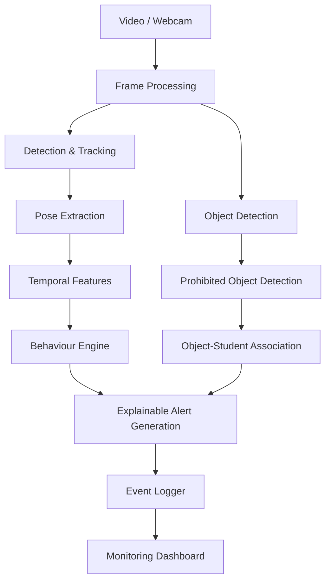

# DRISHTI AI — Examination Monitoring

An AI-powered video analytics system designed for real-time detection of examination misconduct. This system monitors seated students using pose estimation and gesture analysis, identifying suspicious behaviours while preserving privacy.

## 1. Project Overview

Continuous manual observation during physical examinations is difficult and prone to fatigue. The challenge is to develop a system capable of:
- Monitoring students in real time using pose estimation.
- Identifying suspicious behaviors without relying on facial recognition.
- Generating explainable alerts rather than making direct accusations.
- Remaining robust to different camera angles and lighting conditions.

The system aims to act as an automated AI invigilator, processing video feeds to provide objective evidence of potential misconduct.

## 2. Key Features

### Implemented
- **Student/Person Detection**: Uses YOLOv8 (pose) for baseline person detection.
- **Tracking**: Basic integration points for multi-object tracking.
- **Pose Estimation**: Skeleton extraction (YOLO-Pose format) for detecting shoulders, wrists, and nose.
- **Behaviour Analysis Engine**: Rule-based engine capable of identifying:
  - Repeated sideward glances
  - Excessive head turning
  - Body rotation toward neighbours
  - Unusual hand movements
  - Non-verbal communication attempts (hands close to face)
- **Object Detection**: Baseline detection for mobile phones and books (as a proxy for paper/chits).
- **Object-to-Student Association**: Linking detected prohibited items to students using bounding box proximity.
- **Explainable Alerts**: Formats alerts with confidence scores and human-readable reasoning.
- **Logging**: Structured JSON and CSV logging for system events.
- **Dashboard**: A Streamlit dashboard interface for visualizing live alerts and event timelines.

### Planned / Day 3 Work
- Integrating the rule-based `BehaviourEngine` directly into the live perception pipeline.
- Integrating the prohibited-object detector into the live pipeline.
- Generating real-time alerts continuously during video processing.
- Tuning behaviour thresholds using live videos.
- Providing visual alerting overlays on the processed video stream based on the `BehaviourEngine` outputs.

## 3. Technology Stack

| Component        | Technology                 |
| ---------------- | -------------------------- |
| Language         | Python                     |
| Object Detection | YOLOv8 / Ultralytics       |
| Pose Estimation  | YOLO-Pose / MediaPipe      |
| Computer Vision  | OpenCV                     |
| Testing          | Pytest                     |
| Dashboard        | Streamlit, Pandas          |
| Configuration    | YAML                       |

## 4. Architecture



*(Note: The live integration of the perception loop with the behaviour engine is planned for Day 3).*

## 5. Repository Structure

```text
DrishtiAI-project/
├── config.yaml               # Project configuration
├── main.py                   # Main entry point for foundation video pipeline
├── requirements.txt          # Python dependencies
├── docs/
│   ├── context.md            # Hackathon problem statement and context
│   └── false_positives_log.md # Log of false positives
├── src/
│   ├── alerts/               # Alert generation and formatting
│   ├── behaviour/            # Rule-based behaviour analysis engine
│   ├── dashboard/            # Streamlit dashboard interface
│   ├── detection/            # Object detection and association logic
│   ├── pipeline/             # Core video processing loops
│   ├── pose/                 # Pose estimation utility functions
│   ├── tracking/             # Tracking integration points
│   └── utils/                # Logging, schemas, and privacy modules
└── tests/
    ├── integration/          # Integration tests
    └── unit/                 # Unit tests for components
```

## 6. How It Works

The system currently processes video frames sequentially:
1. **Video Pipeline**: Captures frames from webcam or video files.
2. **Perception**: Runs YOLO to detect persons and extract keypoints.
3. **Behaviour**: (To be integrated) Extracts temporal features and applies thresholds for head yaw, body rotation, and hand movement.
4. **Object Detection**: Identifies phones and books, associating them with the nearest student.
5. **Alerts**: When rules are triggered, structured alerts are created with confidence scores and reasoning.
6. **Dashboard**: Reads the logged events and visualizes them for the invigilator.

## 7. Suspicious Behaviour Rules

- **Repeated Sideward Glances**: Head yaw > 20° for 2+ seconds, repeated 3 times within 10 seconds.
- **Excessive Head Turning**: 5 changes in head direction within 15 seconds.
- **Body Rotation**: Shoulder angle > 15° from horizontal.
- **Unusual Hand Movements**: Rapid keypoint displacement > 40px sustained for 3+ seconds.
- **Non-Verbal Communication**: Wrists within 30px of nose/ears sustained for 2+ seconds.
*(Initial/calibration values, requires further tuning).*

## 8. Object Detection

Uses YOLOv8s.pt focusing on classes:
- `67`: cell phone
- `73`: book (used as a baseline proxy for paper/chit due to COCO limitations)
Detected objects are linked to students based on bounding box proximity (default max distance: 150px).

## 9. Alerts

Alerts contain:
- Anonymized Student ID
- Behaviour/Object type
- Confidence score (0.0 to 1.0)
- Human-readable explanation of why the alert triggered
- Frame number / Timestamp

## 10. Installation

```bash
git clone <repository>
cd <repository>

# Create virtual environment
python -m venv .venv
# Activate virtual environment (Windows)
.venv\Scripts\activate
# Activate virtual environment (Linux/macOS)
source .venv/bin/activate

pip install -r requirements.txt
```

## 11. How to Run

**Run tests:**
```bash
python -m pytest tests/
```
*(Or run individual modules: `python -m tests.unit.test_siya`)*

**Run foundational video pipeline:**
```bash
python main.py --source 0
```
*(Uses webcam 0. Alternatively, specify a video path).*

**Run dashboard:**
```bash
streamlit run src/dashboard/dashboard.py
```

**Generate mock alerts for testing the dashboard:**
```bash
python -m src.alerts.mock_alerts
```

## 12. Testing

The `tests/` directory contains unit and integration tests covering:
- Pose extraction logic
- Object detection and association
- Behaviour engine rules and thresholds
- Logger formatting and schema validation

## 13. Configuration

Key parameters are stored in `config.yaml` and internal class defaults (e.g. `behaviour.py` thresholds):
- `video`: Source, max width, display toggles.
- `models`: Paths to `.pt` weights.
- `privacy`: Toggles for anonymization and data retention (storing raw keypoints, omitting names).

## 14. Current Limitations

- **Paper Detection**: Uses `book` class as a proxy since COCO lacks a specific paper/chit class.
- **Integration**: The active perception loop currently runs a basic alert logic instead of fully utilizing the advanced `BehaviourEngine`. (Slated for Day 3).
- **Thresholds**: Behaviour thresholds are theoretical and need empirical calibration.
- **Occlusion**: Students blocking each other from the camera view may impact pose estimation.

## 15. Future Improvements

- Fully integrating the `BehaviourEngine` into the main video pipeline.
- Tuning thresholds on live exam footage.
- Adding custom models for specific paper/chit detection.
- Enhancing multi-camera tracking robustly across blind spots.
