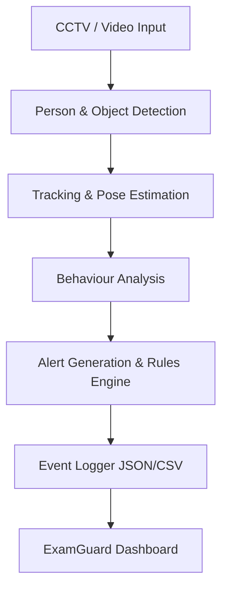

# ExamGuard — AI Monitoring System

## AI-Assisted Examination Monitoring using Computer Vision

ExamGuard (DrishtiAI) is an AI-assisted examination monitoring system that uses computer vision to detect potentially unusual student behaviours and generate alerts for human review.

> **Note:** ExamGuard does not automatically decide whether a student is cheating. Alerts are indicators that require human verification.

---

## 🚀 Project Overview

The system follows this pipeline:

---

## 📌 Current Development Status

The current version is a prototype that successfully integrates end-to-end functionality on sample video data.

- **Day 1  → Foundation + Privacy + Event Logging**: ✅ Working
- **Day 2  → YOLO + Tracking + Pose Estimation**: ✅ Working
- **Day 3  → Video + Behaviour Detection + Alerts**: ✅ Working
- **Day 4  → Streamlit Monitoring Dashboard**: ✅ Working

---

## ✅ What's Working (Implemented Features)

### 1. Foundation & Logging
- Central `EventLogger` storing events in JSON and CSV formats.
- Timestamped events with anonymous student IDs to respect privacy.
- Confidence scores and behaviour explanations included in the logs.

### 2. Computer Vision & Behaviour Analysis
- **YOLO-based** person detection and multi-object tracking.
- **Pose Estimation** extracting body keypoints (nose, shoulder, wrist tracking).
- **Rule-based Behaviour Detection**: 
  - Head direction (Left / Right / Center) and repeated head turns.
  - Sideward glances and wrist/hand movement tracking.
- **Alert Engine**: Rule-based alert generation with cooldowns to prevent spamming.

### 3. Monitoring Dashboard
- Streamlit-based **ExamGuard** interface displaying:
  - **Live Feeds**: Video stream with CV results and lightweight overlays.
  - **Active Alerts**: Recent behavioural flags.
  - **Analytics & Students**: Anonymous student-level events and distribution.
  - **Event Log**: Complete historical record.

---

## 🧠 Technology Stack

- **Core & Backend**: Python
- **Computer Vision**: OpenCV, Ultralytics YOLOv8, YOLO Pose
- **Data & Processing**: NumPy, Pandas
- **UI & Dashboard**: Streamlit
- **Data Storage**: JSON / CSV Logging

---

## ⚠️ Current Limitations

- **Prototype Stage**: The current version is a prototype.
- **Rule-based Logic**: Behaviour detection is mainly rule-based.
- **Pose Dependency**: Head direction relies purely on pose geometry.
- **Tracking Challenges**: Tracking may be affected by occlusion, lighting, or crowded scenes.
- **Calibration Needed**: Alert thresholds require further calibration.
- **Simulated Input**: Current testing primarily uses recorded/sample video.
- **Real Deployment**: Real CCTV/RTSP deployment is not fully implemented yet.
- **False Positives**: AI alerts can produce false positives and require human verification.

---

## 🚧 Roadmap & Left Parts (What's Left)

The following items are planned to transition ExamGuard from a prototype to a production-ready system.

### Computer Vision & Tracking Improvements
- **Multi-person Tracking Consistency**: Solve identity switching, track loss, and duplicate IDs. 
- **Object Detection**: Improve general object detection accuracy.
- **Crowded Seating Visuals**: Remove box alerts in crowded scenes; use only coloured bounding boxes for cleaner visuals.
- **External Datasets**: Train/fine-tune on external datasets to handle poor lighting and blind spots.
- **Blind Spot Handling**: Explicitly alert the system/invigilator when blind spots occur.
- **Non-verbal Communication**: Detect non-verbal cues and suspicious movements.

### Alerting & Logic Refinements
- **False Positive/Negative Correction**: Calibrate thresholds to minimize false alarms.
- **Confidence & Explainability**: Ensure confidence percentages are logged, then flag them for explainable alerts.
- **Visual Evidence**: Attach visual evidence, explicit reasons, and correct time zones for every alert.
- **Invigilator Ruleset**: Distinguish between an invigilator standing or sitting on a desk vs. a student.
- **Multi-Camera Deduplication**: If the same student is cheating on multiple cameras, trigger **1 unified alert** instead of 2.
- *(Optional)* **Reinforcement**: Implement a feedback loop for false alarms.
- *(Optional)* **LLM Integration**: Use LLMs for better explainable framing of the alerts.

### UI Integration (Kavya's Tasks)
- **Log Integration**: Extract info and degree of head movement, etc., directly from logs and integrate them seamlessly into the Streamlit UI.
- **Alert Visibility**: Ensure alerts remain visible and clear even after bounding box thinning in the video feed.

### System, Storage & Infrastructure
- **Real-time Video Ingestion**: Figure out the exact architecture for real-time video ingestion from cameras (RTSP/IP integration).
- **ID Management on Failure**: Manage Student IDs gracefully post-camera failure (e.g., maintaining position ID or generating next exam student ID).
- **Storage Output Plan**: Finalize the architecture and planning for scalable video/log storage output.
- **Network Resilience**: Build robust logs and fallbacks for network failures (needs more thought).
- **Time Zone Accuracy**: Ensure strict time zone checks are correct for all logs and alerts.

---

## ⚖️ Disclaimer

ExamGuard is an experimental AI-assisted monitoring system. Computer vision results can be affected by lighting, camera position, occlusion, image quality, and student posture.

**AI-generated alerts must be treated as signals for human review and not as definitive evidence of cheating or academic misconduct.** For more detailed context, refer to the documentation inside the `info/` directory.
