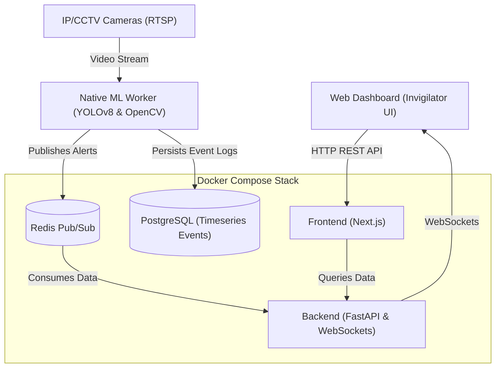

# Drishti AI (ExamGuard) — Enterprise AI Examination Monitoring System


**Drishti AI (ExamGuard)** is an enterprise-grade, AI-assisted examination monitoring and proctoring system. Engineered to operate at scale in high-stakes assessment environments, it leverages state-of-the-art computer vision, edge-based machine learning, and explainable behavioral heuristics to assist human invigilators with real-time, highly accurate alerts.

Unlike traditional automated proctoring solutions that act as autonomous judges, Drishti AI serves as an **Explainable AI (XAI) augmentation tool**. It provides context-aware, verifiable alerts to human operators without making opaque punitive decisions.

---

## 📖 Table of Contents
1. [Executive Summary](#-executive-summary)
2. [Unique Value Proposition (UVP)](#-unique-value-proposition-uvp)
3. [System Architecture](#-system-architecture)
4. [Machine Learning Pipeline](#-machine-learning-pipeline)
5. [Core Technology Stack](#-core-technology-stack)
6. [Operational Edge Cases & Resilience](#-operational-edge-cases--resilience)
7. [Security & Compliance](#-security--compliance)
8. [API & Integration](#-api--integration)
9. [Deployment Guide](#-deployment-guide)
10. [Limitations & Roadmap](#-limitations--roadmap)
11. [Acknowledgments](#-acknowledgments)

---

## 🎯 Executive Summary
Manual invigilation in large-scale examination halls is fundamentally limited by human fatigue, cognitive overload, and physical blind spots. **Drishti AI solves this by automating the continuous visual assessment of examination halls.** By analyzing high-resolution IP camera feeds in real-time, the system detects suspicious activities, unauthorized materials, and behavioral anomalies, instantly flagging them on a centralized operations dashboard.

**Primary Use Cases:**
- **University Examination Halls:** Large-scale monitoring across multiple concurrent venues.
- **Certification & Testing Centers:** Ensuring strict compliance for high-stakes professional examinations.
- **Remote Proctoring Hubs:** Enabling centralized, multi-tenant monitoring where a single invigilator can effectively oversee dozens of camera feeds.

---

## 🚀 Unique Value Proposition (UVP)

- **Explainable AI (XAI) Engine:** Alerts are fully transparent. Rather than a binary "Cheating Detected" flag, the system issues specific, evidence-backed alerts such as *"Sustained Gaze (78% Confidence)"*, *"Unauthorized Object Detected (Phone)"*, or *"Repeated Sideward Glances"*.
- **Privacy-Preserving Edge Processing:** Video feeds are processed entirely on local edge hardware. Sensitive video streams are never transmitted to external cloud providers, ensuring strict compliance with GDPR, FERPA, and institutional privacy policies.
- **Adaptive Dynamic Thresholding:** The system builds personalized, real-time statistical baselines for every tracked individual. This dynamically differentiates between natural body sway, benign fidgeting, and actual suspicious behavior.
- **Highly Decoupled, Fault-Tolerant Architecture:** The heavy-lifting ML pipeline runs natively to maximize GPU throughput, while the operational web stack (Next.js + FastAPI) is fully containerized, stateless, and orchestrated via Docker.

---

## 🏗️ System Architecture

Drishti AI is built on a highly modular, event-driven architecture designed for high availability and low latency.



### Component Breakdown
1. **Edge ML Inference Node (Python):** Connects directly to RTSP/HTTP video streams. Executes object detection, pose estimation, and behavioral heuristics.
2. **Message Broker (Redis):** Acts as the high-throughput, low-latency arterial network for real-time alert propagation from the ML node to the web stack.
3. **Core API Services (FastAPI):** Manages historical event queries, system configuration, and maintains stateful WebSocket connections with the frontend clients.
4. **Operations Dashboard (Next.js):** A modern, reactive single-page application providing real-time telemetry, historical analytics, and verifiable alert logs to the human operators.

---

## 🧠 Machine Learning Pipeline

The inference pipeline is engineered for precision, capable of running continuously at 30+ FPS on edge GPU hardware.

### 1. Spatial Perception & Tracking
- **Skeletal Pose Estimation:** Utilizes **YOLOv8-Pose** to extract 17 high-fidelity human skeletal keypoints (eyes, ears, shoulders, wrists, ankles).
- **Prohibited Object Detection:** A secondary YOLO layer trained to identify unauthorized items (mobile devices, smartwatches, external notes) with high confidence.
- **Multi-Object Tracking (MOT):** Integrates **ByteTrack** to maintain persistent temporal tracking of individuals, gracefully handling occlusions and cross-trajectories.

### 2. Behavioral Heuristics Engine
- **Dual-Triangle Head Pose Estimation:** Implements a geometric approach (inspired by Haider et al. 2025) calculating vectors between (Nose-Left Eye-Right Eye) and (Nose-Left Ear-Right Ear). This generates a robust continuous `turn_score` unaffected by the camera's absolute mounting angle.
- **Temporal Memory Buffering:** Maintains a rolling spatio-temporal buffer (e.g., 60 frames) of skeletal vectors (shoulder angles, wrist displacement) to detect sustained actions like *leaning*, *paper gazing*, or *non-verbal communication*.

### 3. Dynamic Baselines & Statistical Filtering
Rather than relying on brittle, static thresholds, the system calculates a rolling **median** and **standard deviation** for every tracked individual. Alerts are triggered exclusively when an individual's movements deviate significantly from their own personalized baseline (`DYNAMIC_BASE` + `DYNAMIC_STD_MULT * std`).

---

## 💻 Core Technology Stack

| Domain | Technologies | Justification |
| :--- | :--- | :--- |
| **Frontend Platform** | Next.js 16.3, React 19, TypeScript | Server-side rendering, robust typing, and enterprise scalability. |
| **UI/UX & Data Viz** | Tailwind CSS v4, Shadcn UI, Recharts | Accessible, highly customizable UI primitives and performant telemetry charts. |
| **Backend Services** | FastAPI, Python 3.10+ | Asynchronous event loop, built-in validation (Pydantic), and high-performance WebSockets. |
| **Data Persistence**| PostgreSQL 15, SQLAlchemy, Alembic | ACID-compliant relational storage for audit logs and event history. |
| **In-Memory Cache**| Redis 7 | Sub-millisecond Pub/Sub messaging for real-time alert distribution. |
| **Machine Learning**| PyTorch, Ultralytics YOLOv8, OpenCV | Industry-standard tensors, optimized inference, and hardware acceleration. |
| **Infrastructure** | Docker, Docker Compose | Immutable infrastructure, deterministic builds, and simplified horizontal scaling. |

---

## 🛡️ Operational Edge Cases & Resilience

The system includes sophisticated logic to suppress false positives and handle real-world operational anomalies:

1. **Invigilator Presence Suppression:** 
   *Challenge:* Students naturally look at a walking invigilator, triggering false "Sustained Gaze" alerts.
   *Solution:* The pipeline uses bounding box height-ratios and spatial memory to identify standing/walking invigilators. It suppresses alerts for any student whose gaze vector intersects with the invigilator's spatial coordinates.
2. **Dense Bounding Box Overlaps:** 
   *Challenge:* In crowded halls, inference engines often generate duplicate bounding boxes for the same individual.
   *Solution:* A custom Intersection over Union (IoU) filtering mechanism continuously cleans up duplicate tracks before they reach the heuristics engine.
3. **Variable Lighting Conditions:** 
   *Challenge:* Examination halls often suffer from glare, shadows, or dim lighting.
   *Solution:* The pipeline applies dynamic CLAHE (Contrast Limited Adaptive Histogram Equalization) preprocessing to normalize frames before inference.
4. **Natural Fidgeting & Sway:** 
   *Challenge:* Highly anxious students exhibit natural body sway.
   *Solution:* Filtered out entirely by the dynamic statistical baseline engine.

---

## 🔐 Security & Compliance

Designed with enterprise security postures in mind:
- **Zero-Trust Video Processing:** Video frames are analyzed in memory and immediately discarded. Only the cropped "evidence frames" of flagged anomalies are persisted.
- **JWT Authentication:** (Pending Implementation in Staging) All API routes and WebSocket connections are secured via signed JSON Web Tokens.
- **Data Retention Policies:** Configurable TTLs on PostgreSQL event logs to comply with data minimization principles.

---

## 🔌 API & Integration

Drishti AI exposes a comprehensive RESTful API for integration with existing Learning Management Systems (LMS) or Enterprise Resource Planning (ERP) tools.

- `GET /api/health` — Infrastructure liveness probe.
- `GET /api/analytics/summary` — Time-series aggregation of active alerts and system load.
- `GET /api/events` — Paginated, filterable historical audit logs.
- `WS /api/ws/alerts` — Real-time binary WebSocket stream for low-latency frontend updates.

---

## 🚀 Deployment Guide

### Prerequisites
- Docker Engine 24.0+ & Docker Compose v2.
- NVIDIA Driver & CUDA Toolkit 11.8+ (For native ML Worker inference).
- Python 3.10+ (For ML Worker environment).

### 1. Environment Configuration
Clone the repository and provision the environment variables:
```bash
git clone https://github.com/DrishtiAI-DJSCE/DI1_11_CaseBlitz.git
cd DI1_11_CaseBlitz

# Provision configuration files
cp .env.example .env
cp backend/.env.example backend/.env
cp frontend/.env.example frontend/.env.local
cp ml_worker/.env.example ml_worker/.env
```

### 2. Provision Core Infrastructure (Docker)
Initialize the PostgreSQL database, Redis broker, Backend API, and Next.js Frontend:
```bash
docker compose up --build -d

# Execute database schema migrations
docker compose exec backend alembic upgrade head
```

### 3. Launch Edge ML Inference Worker
The ML worker runs natively on the host to seamlessly interface with local hardware accelerators (GPUs) and USB/RTSP camera feeds without complex Docker GPU passthrough configurations.
```bash
# Activate your python virtual environment
python -m venv .venv
source .venv/bin/activate
pip install -r backend/requirements.txt

# Start the inference engine
python ml_worker/worker.py
```

### 4. Access Operations Dashboard
Navigate to `http://localhost:3000` in your browser.  
*(Note: For local development and demonstration purposes, a temporary auth bypass is active. Use Username: `admin`, Password: `1234`)*

---

## ⚠️ Limitations & Roadmap

While Drishti AI is robust, the current build has known limitations targeted for upcoming release cycles:
- **High-Density Occlusion:** In extremely crowded setups with complex desk geometries, lower-body skeletal tracking fidelity may degrade.
- **Multi-Camera Re-ID:** While tracking within a single frame is highly accurate via ByteTrack, seamless multi-camera identity handoff (Re-ID) is currently in experimental phases.
- **Transport Encryption:** Local MJPEG video transport and WebSocket streams are currently unencrypted. Production deployments must place the stack behind an HTTPS-terminated reverse proxy (e.g., NGINX, Traefik, or AWS ALB).
- **Cloud Federation:** The current architecture is designed for edge-local operations. Future roadmaps include a lightweight agent to push aggregated, anonymized telemetry to a centralized cloud dashboard for multi-campus reporting.

---

## 🏆 Acknowledgments

**Built for the Drishti AI Hackathon.**  
Drishti AI (ExamGuard) was conceptualized, engineered, and delivered as a core submission for the Drishti AI hackathon. The project represents a commitment to advancing ethical, explainable AI solutions within the education sector, proving that automated proctoring can be privacy-respecting, transparent, and highly effective.
